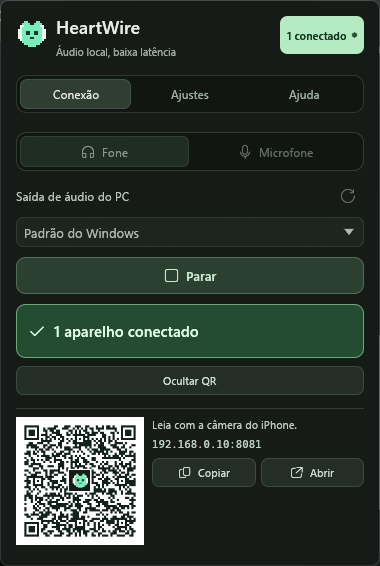
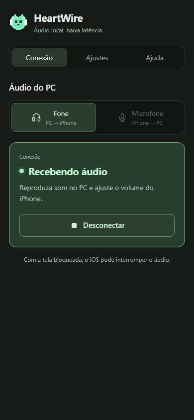
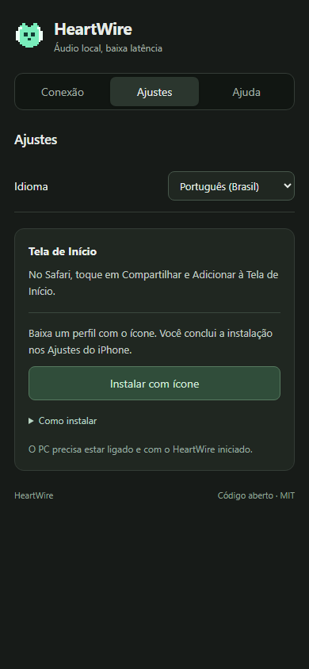

<div align="center">
  
  <h1>HeartWire</h1>
  <p>Local audio, low latency</p>
  <p>
    <a href="CHANGELOG.en.md"></a>
    <a href="docs/en/development.md"></a>
    <a href="Cargo.toml"></a>
    <a href="crates/heartwire/Cargo.toml"></a>
    <a href="docs/en/architecture.md"></a>
    <a href="LICENSE"></a>
  </p>
  <p>
    <a href="https://github.com/saitofernando/heartwire/releases/download/v0.1.0/HeartWire_0.1.0_x64-setup.exe">Download for Windows</a> ·
    <a href="#installation-and-use">Use</a> ·
    <a href="#iphone-pwa-and-web-clip">iPhone and PWA</a> ·
    <a href="#technology">Technology</a> ·
    <a href="docs/en/README.md">Documentation</a> ·
    <a href="CONTRIBUTING.en.md">Contribute</a>
  </p>
</div>

[Português (Brasil)](README.md) · **English**

**Version: 0.1.0** · Windows 10/11 x64 · [MIT](LICENSE)

Stream Windows audio to your iPhone or use the phone as a microphone over the local network. On Windows, HeartWire is a native Rust app in the system tray; on the phone, it opens as an HTML and JavaScript web miniapp served by the computer itself. No account, no cloud and no phone app to install.

## Interface

<table>
  <tr>
    <th>Windows · tray</th>
    <th>Phone · connection</th>
    <th>Phone · installation</th>
  </tr>
  <tr>
    <td valign="top"></td>
    <td valign="top"></td>
    <td valign="top"></td>
  </tr>
</table>

<sub>The Windows screenshot uses `--demo` mode, with sample data and a demonstration QR; the mobile images are browser previews, without a physical iPhone screenshot. To connect, scan the QR in HeartWire running on your computer.</sub>

- **Native panel:** named devices, start/stop, connected-device count and a collapsible QR code with the original icon in its center. With screen-reader support.
- **Two modes:** listen to the computer on your phone or send the phone microphone to Windows.
- **System tray:** click outside or press Esc to hide the panel while streaming continues.
- **Settings:** PT-BR/English, port and optional start with Windows.

## Installation and use

Download **[HeartWire 0.1.0 for Windows x64](https://github.com/saitofernando/heartwire/releases/download/v0.1.0/HeartWire_0.1.0_x64-setup.exe)** and run the installer. It installs for the current user without administrator rights. Rust and NSIS are needed only to [build from source](#build). [Release notes](https://github.com/saitofernando/heartwire/releases/tag/v0.1.0).

1. Install HeartWire and click its system tray icon.
2. Choose **Headphones** or **Microphone** and the audio device.
3. Click **Start** and scan the QR code with your iPhone camera.
4. Open the HTTPS address and tap **Connect** on the phone.

Computer and phone must share a network. Before accepting a local certificate warning on first use, check the IP shown in the app. Default port: **8081**.

| Mode | Audio path |
| --- | --- |
| Headphones | Selected Windows output → phone → headphones. |
| Microphone | Phone microphone → selected Windows output. For Discord, OBS or Zoom, select **CABLE Input** in HeartWire and **CABLE Output** in the other app. Install VB-CABLE separately. |

The green indicator counts active WebRTC connections. **Stop** ends the stream; **Quit** in the tray menu exits the app. [Usage guide](docs/en/usage.md).

## iPhone: PWA and Web Clip

| Feature | Role in HeartWire |
| --- | --- |
| **PWA** | Web miniapp with a manifest, icons and a service worker for public interface resources. |
| **Web Clip** | Apple shortcut with an address, embedded icon and full-screen launch, installed through a `.mobileconfig` profile. |

To install with the icon included:

1. Open HeartWire in Safari and choose **Settings → Install with icon**.
2. Read the notice and allow the profile download.
3. Open **iPhone Settings → Profile Downloaded → Install**.
4. Return to the Home Screen and open the new **HeartWire** icon.

The miniapp keeps instructions pending after tapping and shows **Opened from the Home Screen** when running in that mode. Downloading the file alone does not confirm installation; the website cannot inspect iPhone profiles.

The profile appears under **VPN & Device Management** because iOS groups configuration profiles there. It contains only the shortcut: no VPN, certificates or remote device management. **Share → Add to Home Screen** remains available without a profile. [Installation and removal](docs/en/usage.md#install-on-the-home-screen).

PWA caching requires trusted HTTPS; accepting a navigation warning may not be enough. Audio requires the running computer and local connection. In Headphones mode, Media Session integration supplies its name, icon and commands to the system; iOS decides whether to show lock-screen controls and keep background audio running. [Limitations and troubleshooting](docs/en/troubleshooting.md).

## How it works

**WASAPI → Opus → WebRTC → phone.** In Microphone mode, audio travels back from the phone to a Windows output.

The engine uses **20 ms** frames, discards stale capture and keeps sending during silence. Total latency depends on the network, browser and headphones, especially Bluetooth; frame size does not represent final latency. [Architecture and invariants](docs/en/architecture.md).

The app implements no accounts, telemetry or cloud audio server. It is intended for a **trusted local network**, without individual device authentication. [Security and privacy](docs/en/security.md).

## Technology

A Rust 2024 workspace holds the audio engine, the Windows app and repository tasks. The phone uses only HTML, CSS and JavaScript, with no framework and no build step.

| Where | Technology |
| --- | --- |
| Windows panel and tray | Native Rust: egui/eframe (OpenGL), `tray-icon`/`muda`, AccessKit and Win32 through the `windows` crate. |
| Audio engine | Rust: WASAPI, Opus, WebRTC (`webrtc-rs`), tokio and an HTTPS server with axum/rustls. |
| Phone | HTML, CSS and JavaScript: WebRTC, Media Session, Wake Lock, a service worker and a PWA manifest. |
| Quality and delivery | `cargo test`, clippy, Node tests, headless Edge over CDP, GitHub Actions and an NSIS installer. |

### Windows: panel and tray (`crates/heartwire`)

- **egui/eframe 0.37** in immediate mode with OpenGL rendering. The choice was measured: about 80–90 MB with OpenGL versus more than 330 MB with DX12 or WARP for this panel.
- **Custom widget** (`PanelButton`) with rest, hover, selected, disabled and keyboard-focus states; **AccessKit** reports name, role (button, tab) and selection to screen readers.
- **Tray** with `tray-icon` and `muda`. The panel opens against the taskbar edge, top, bottom or sides, computed from the monitor's work area, and also works with the icon in the hidden-icons flyout.
- **Win32** through the `windows` crate: named mutex and events for single instance and `--quit`; DWM for rounded corners; the registry (`windows-registry`) for start with Windows, respecting Task Manager; `ShellExecuteW` to open links.
- **Concurrency:** a multi-threaded tokio runtime. The UI never blocks: it reads state with `try_lock`, and async tasks return events over a channel and wake egui with `request_repaint`, even while the window is hidden.
- **QR** generated in Rust (`qrcode`, H error correction, icon in the center) and verified in tests by decoding the image with `rqrr`.
- Windows' own fonts and icons (Segoe UI and Segoe Fluent Icons), with no bundled font files. `--demo` shows sample data for screenshots.

### Audio engine (`crates/bridge-core`)

- **WASAPI** event-driven loopback on dedicated COM threads. 20 ms frames (960 stereo samples at 48 kHz) go through a `watch` channel: always the latest frame, never a growing queue.
- **Cadence:** a monotonic 20 ms schedule that sends silence when capture stalls, a gapless RTP clock and a microphone playback queue bounded to 40 ms. `timeBeginPeriod(1)`, high thread priority and disabled power throttling keep timing stable.
- **Opus** (libopus built with CMake): stereo, in-band FEC and up to 128 kbps.
- **WebRTC** with `webrtc-rs` (ICE and DTLS-SRTP), local-network candidates only, no STUN/TURN; HTTP signaling with complete offer and answer.
- **HTTPS:** axum 0.8, axum-server and rustls with HTTP/2; a self-signed certificate generated with `rcgen` and renewed when the IP changes; strict CSP, Host and Origin validation and an eight-device limit.
- **Web Clip:** a `.mobileconfig` profile generated with `plist`, with UUID v5 identifiers stable per address.

### Phone (`web/`)

- Plain HTML, CSS and JavaScript, with no npm dependencies and no build; the files are embedded in the executable with `include_bytes!`.
- `RTCPeerConnection` with `playoutDelayHint` and `jitterBufferTarget` at zero for Safari's smallest buffer; `getUserMedia` in Microphone mode.
- Media Session for lock-screen controls, Wake Lock, a service worker that caches only public resources and a PWA manifest.

### Quality and delivery

- Rust tests for cadence, RTP continuity, certificates, origin, Web Clip, the HTTP/2 server, panel placement and QR; `clippy -D warnings` and `rustfmt`.
- Node tests (`node:test`) for the service worker and Media Session; browser tests in headless Edge over CDP, without Puppeteer; a real WebRTC probe against the app.
- GitHub Actions on `windows-latest`, a license inventory of more than 400 packages with hashes, and link and version checks.
- `cargo xtask icons` generates every icon from the 16×16 artwork; a per-user NSIS installer with a welcome page.

```text
crates/bridge-core   audio engine, HTTPS server and WebRTC
crates/heartwire     Windows app: egui panel, tray and installer
web/                 phone miniapp (HTML, CSS and JavaScript)
xtask/               repository tasks, such as cargo xtask icons
scripts/             checks, browser tests and packaging
docs/                PT-BR and EN documentation
```

## Build

Requirements: Windows x64, Rust MSVC **1.90+**, Visual Studio C++ Build Tools, Windows SDK and CMake. The installer requires NSIS 3. Node.js **22.12+** is used only for repository checks and miniapp tests; it is not part of the app.

```powershell
cargo run -p heartwire
cargo test --workspace
```

To generate the installer:

```powershell
npm ci
npm run licenses:generate
npm run release:check
pwsh -NoProfile -File scripts/package.ps1
```

Outputs: `target/release/heartwire.exe` and `target/release/bundle/nsis/HeartWire_<version>_x64-setup.exe`. The package includes licenses and documentation. [Environment and tests](docs/en/development.md) · [Validation results](VALIDACAO.en.md).

## Documentation and contributions

[Usage](docs/en/usage.md) · [Troubleshooting](docs/en/troubleshooting.md) · [Architecture](docs/en/architecture.md) · [Versions](docs/en/versioning-and-releases.md) · [Changelog](CHANGELOG.en.md) · [Contribute](CONTRIBUTING.en.md) · [Security](SECURITY.md)

Brazilian Portuguese is the primary documentation language. [Documentação em português](docs/pt-BR/README.md).

## License and authorship

Created and maintained by **[saitofernando](https://github.com/saitofernando)**. HeartWire is distributed under [MIT](LICENSE). Third-party components retain their notices in [NOTICE](NOTICE) and [THIRD_PARTY_NOTICES.md](THIRD_PARTY_NOTICES.md).

[fernandosaito@hotmail.com.br](mailto:fernandosaito@hotmail.com.br)
