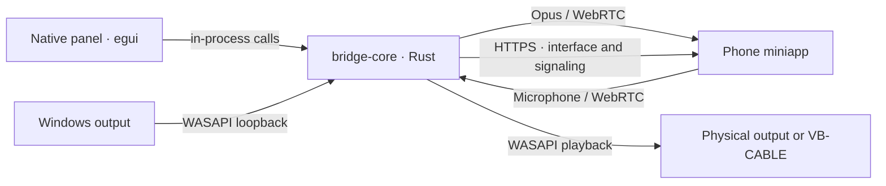

# Architecture

[Português (Brasil)](../pt-BR/arquitetura.md) · **English** · [Index](README.md)

## Components

The desktop controls one `BridgeService` at a time. Headphones mode opens selected capture; Microphone mode opens playback when a remote track arrives. Endpoints reject incompatible modes. The engine does not depend on the panel; examples and tests instantiate it independently.

| Layer | Responsibility |
| --- | --- |
| `crates/bridge-core` | Devices, audio clock, Opus, WebRTC, HTTPS and certificates. |
| `crates/heartwire` | egui/eframe panel, tray, QR, preferences, single instance, panel placement and autostart; no audio capture. |
| `web` | Mobile client, languages, manifest and service worker. |

## Audio invariants

- 48 kHz stereo interleaved s16 PCM; 960 samples per channel in each 20 ms frame.
- Capture publishes only the latest block through `watch`; there is no growing capture queue.
- Real capture arrival drives sending; silence follows the same absolute schedule when WASAPI stops delivering data.
- RTP advances exactly 960 samples per frame. Dropped capture does not create clock jumps.
- 40 ms tolerance for late capture; delays above 60 ms reanchor the deadline without catch-up bursts.
- Silence continues producing Opus packets; the computer sender does not use DTX.
- Microphone playback bounds its queue and discards old audio, including long packets.

WASAPI may pause during silence. If sending pauses too, the browser can treat returning audio as delayed and increase buffering. Continuous cadence limits this problem. The 20 ms frame does not represent total latency; network, codec, browser and device also contribute.

## Windows and lifecycle

WASAPI runs on dedicated threads with balanced COM initialization. Stable device IDs are persisted alongside displayed names. During streaming, a guard requests a 1 ms timer and elevated priority, restoring state when it ends. These are Windows requests, not real-time guarantees.

The panel is native Rust (egui/eframe with OpenGL), with screen-reader accessibility through AccessKit, and calls the controller directly in the same process, without IPC. It is 380 px wide, adjusts its height to the content between 350 and 600 px and starts hidden. It opens against the taskbar edge, aligned with the tray icon, has no taskbar entry or title bar and hides on focus loss or Esc. Hiding does not cancel audio. Stop cancels tasks, closes peers, releases the port and joins audio threads.

The counter represents connected WebRTC peers, not open pages. Preferences, language, certificate and logs live in `%LOCALAPPDATA%\com.heartwire.desktop`, the same folder as 0.1.0; `HEARTWIRE_DATA_DIR` overrides it for development and tests.

A second launch does not keep another copy running: a named mutex identifies the running instance, and the new process signals it through events, asking it to open the panel or, with `--quit`, to stop audio and exit. `--minimized`, used when starting with Windows, starts audio in the tray and opens the panel only if starting fails.

The QR is generated locally in Rust (`crates/heartwire/src/qr.rs`), with H error correction, a four-module quiet zone and the app icon in its center. Its address is not sent to an external QR service. The default panel size is 128 px; the icon keeps the identity's drawing and colors.

## HTTPS and mobile client

One port serves the interface, icons, manifest, service worker, `/status`, `/offer` and `/mic-offer`. Static resources use an allowlist; signaling responses are not cached.

`/install/heartwire.mobileconfig?lang=pt-BR|en` generates `HeartWire.mobileconfig` with MIME `application/x-apple-aspen-config` and `no-store`. The unsigned profile contains one WebClip: embedded original 180 px PNG, `FullScreen`, `IsRemovable` and `Precomposed` enabled, and `IgnoreManifestScope` disabled. Its identifier is stable per origin and independent of language. There is no CA or MDM payload.

The shortcut address comes from HTTP/2 authority or HTTP/1.1 Host, validated against local service addresses and port. Proxy headers are ignored; no arbitrary target URL is accepted as a parameter. Only supported languages are accepted. The profile leaves the existing HTTPS certificate unchanged.

The client separates an installation request from Home Screen launch. A click keeps instructions pending; it confirms neither the download nor profile installation. `navigator.standalone` or `display-mode: standalone/fullscreen` identify the current presentation and allow **Opened from the Home Screen** to appear. There is no installed-profile lookup, and Safari storage can be separate from the app.

The local certificate covers computer IPs. Valid certificates are reused; new addresses or damaged files trigger renewal. The manifest selects standalone launch; the worker provides only the interface/offline experience, without storing audio, offers, answers or connection state.

In Headphones mode, `web/media-session.js` supplies playback metadata and commands to the system. State follows the session and audio element: pause keeps the peer; play resumes only a valid session; stop disconnects. Microphone mode does not expose these commands. Clearing the session removes metadata and handlers. This integration adds no silent track, leaves WebRTC cadence unchanged and does not guarantee that iOS displays controls or keeps the app running in the background.

Negotiation uses complete ICE without trickle and without configured STUN/TURN. HTTPS origin is compared with HTTP/2 `:authority` or HTTP/1.1 `Host`, ignoring proxy headers. This restricts external pages but does not authenticate devices. See [security](security.md).
