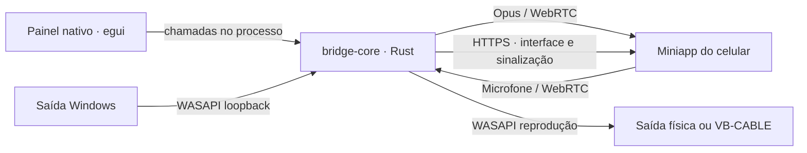

# Arquitetura

**Português (Brasil)** · [English](../en/architecture.md) · [Índice](README.md)

## Componentes

O desktop controla um `BridgeService` por vez. Em Fone, abre a captura selecionada; em Microfone, abre a saída quando recebe uma faixa remota. Endpoints recusam o modo incompatível. O motor não depende do painel; exemplos e testes podem instanciá-lo sem a interface.

| Camada | Responsabilidade |
| --- | --- |
| `crates/bridge-core` | Dispositivos, relógio de áudio, Opus, WebRTC, HTTPS e certificados. |
| `crates/heartwire` | Painel egui/eframe, bandeja, QR, preferências, instância única, posição do painel e autostart; não captura áudio. |
| `web` | Cliente móvel, idiomas, manifesto e service worker. |

## Invariantes do áudio

- PCM de 48 kHz, estéreo, s16 intercalado; 960 amostras por canal em cada quadro de 20 ms.
- A captura publica o bloco mais recente em um canal `watch`; não acumula uma fila de captura.
- Chegada de áudio real dirige o envio; silêncio usa o mesmo agendamento absoluto quando o WASAPI deixa de entregar dados.
- RTP avança exatamente 960 amostras por quadro. Descartar captura não cria saltos no relógio.
- Tolerância de 40 ms para captura atrasada; atrasos acima de 60 ms reposicionam o prazo sem rajadas de recuperação.
- Silêncio continua produzindo pacotes Opus; o envio do PC não usa DTX.
- A reprodução do microfone limita a fila e descarta áudio antigo, incluindo pacotes longos.

O WASAPI pode parar no silêncio. Se o envio também parar, o navegador pode interpretar o retorno como atraso e aumentar o buffer. A cadência contínua limita esse problema. O quadro de 20 ms não representa a latência total; rede, codec, navegador e dispositivo também contribuem.

## Windows e ciclo de vida

WASAPI usa threads dedicadas e inicialização COM balanceada. IDs de dispositivos são persistidos junto aos nomes apresentados. Durante a transmissão, um guard solicita temporizador de 1 ms e prioridade elevada, com restauração ao encerrar. São solicitações ao Windows, não garantias de tempo real.

O painel é Rust nativo (egui/eframe com OpenGL), com acessibilidade para leitores de tela por AccessKit, e chama o controlador diretamente no mesmo processo, sem IPC. Tem 380 px de largura, altura ajustada ao conteúdo entre 350 e 600 px e fica oculto inicialmente. Abre encostado na borda da barra de tarefas, alinhado ao ícone da bandeja, não aparece na barra de tarefas, não tem barra de título e se recolhe ao perder foco ou receber Esc. Ocultar não cancela áudio. Parar cancela tarefas, fecha peers, libera a porta e aguarda as threads.

A contagem representa peers WebRTC em estado conectado, não páginas abertas. Preferências, idioma, certificado e logs ficam em `%LOCALAPPDATA%\com.heartwire.desktop`, a mesma pasta da 0.1.0; `HEARTWIRE_DATA_DIR` troca essa pasta em desenvolvimento e testes.

Uma segunda execução não mantém outra cópia aberta: um mutex nomeado identifica a instância ativa, e o novo processo envia a ela, por eventos, o pedido de abrir o painel ou, com `--quit`, de parar o áudio e encerrar. `--minimized`, usado ao iniciar com o Windows, inicia o áudio na bandeja e só abre o painel se a inicialização falhar.

O QR é gerado localmente em Rust (`crates/heartwire/src/qr.rs`), com correção de erros H, margem de quatro módulos e o ícone do app no centro. O endereço não é enviado a um serviço externo de QR. O tamanho padrão no painel é 128 px; o ícone preserva o desenho e as cores da identidade.

## HTTPS e cliente móvel

Uma porta serve a interface, os ícones, o manifesto, o service worker, `/status`, `/offer` e `/mic-offer`. Recursos estáticos são servidos por lista permitida; sinalização usa respostas sem cache.

`/install/heartwire.mobileconfig?lang=pt-BR|en` gera `HeartWire.mobileconfig` com MIME `application/x-apple-aspen-config` e `no-store`. É um perfil não assinado com um único WebClip: PNG original de 180 px embutido, `FullScreen`, `IsRemovable` e `Precomposed` ativos, `IgnoreManifestScope` desativado. O identificador é estável por origem e não varia com o idioma. Não há payload de CA ou MDM.

O endereço do atalho vem da autoridade HTTP/2 ou do Host HTTP/1.1, validado contra os endereços locais e a porta do serviço. Cabeçalhos de proxy não são usados; a requisição não recebe um destino arbitrário por parâmetro. Somente os idiomas previstos são aceitos. O perfil não altera o certificado HTTPS existente.

O cliente separa solicitação de instalação e abertura pela Tela de Início. O clique mantém instruções pendentes; não confirma o download nem a instalação do perfil. `navigator.standalone` ou `display-mode: standalone/fullscreen` identificam a apresentação atual e permitem mostrar **Aberto pela Tela de Início**. Não há consulta de perfis instalados, e o armazenamento do Safari pode ser separado do app.

O certificado local contém os IPs da máquina. Ele é reutilizado quando válido e renovado para endereços novos ou arquivos danificados. O manifesto define abertura standalone; o service worker fornece apenas a interface/offline, sem guardar áudio, ofertas, respostas ou estado de conexão.

Em Fone, `web/media-session.js` fornece metadados e comandos de reprodução ao sistema. O estado acompanha a sessão e o elemento de áudio: pausar mantém o peer; reproduzir retoma somente uma sessão válida; parar desconecta. O modo Microfone não recebe esses comandos. Limpar a sessão remove metadados e handlers. Essa integração não adiciona uma faixa silenciosa, não altera a cadência WebRTC e não garante que o iOS exiba controles ou mantenha o app em segundo plano.

A negociação usa ICE completo, sem trickle e sem STUN/TURN configurado. A origem HTTPS é comparada a `:authority` em HTTP/2 e `Host` em HTTP/1.1, sem confiar em cabeçalhos de proxy. Isso restringe páginas externas, mas não autentica aparelhos. Veja [segurança](seguranca.md).
